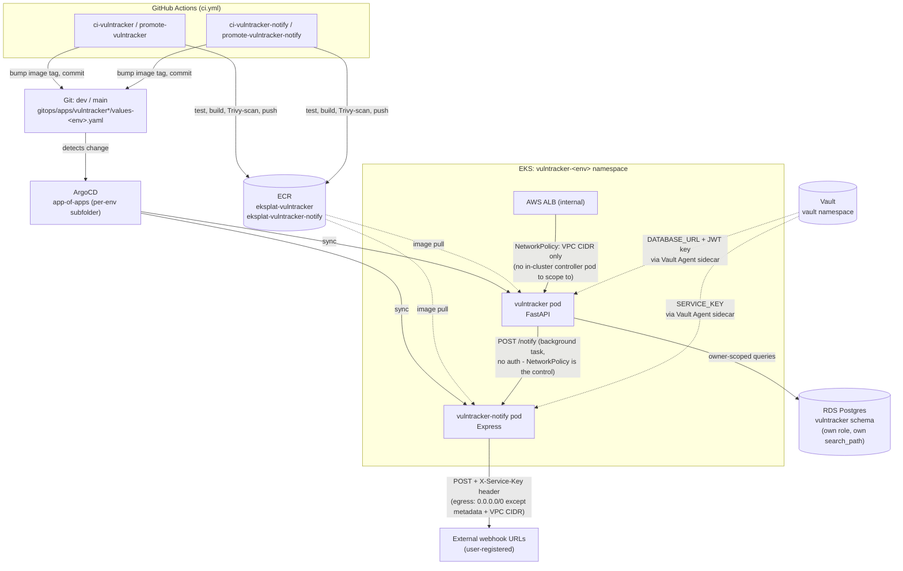
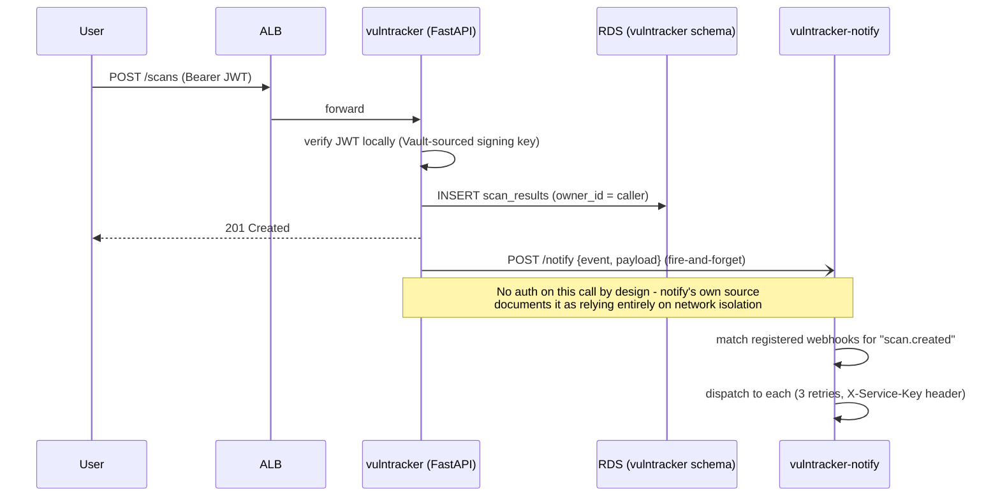

# EKS Platform Demo

A production-style reference implementation for deploying a frontend + backend
application onto AWS EKS using:

- **Terraform** (module-based, one workspace per environment: `dev` / `stage` / `prod`)
- **GitHub Actions** for CI/CD, with security scanning gating every deploy
- **ArgoCD** for GitOps-based delivery
- **Helm** for packaging the frontend and backend
- **HashiCorp Vault** for application, database, and API-token secrets
- **AWS Secrets Manager** for the one credential Vault doesn't hold: the
  GitHub token CI uses to push GitOps commits

## Repository layout

```
terraform/
  modules/            # vpc, oidc, eks, add-ons, alb, argocd, bastion, cognito, rds, vault, observability
  environments/        # root config that wires modules together, one per workspace
    dev/terraform.tfvars
    stage/terraform.tfvars
    prod/terraform.tfvars
apps/
  frontend/            # sample React app
  backend/             # sample Node/Express API - index.js (HTTP), worker.js (SQS consumer), cron.js (scheduled task)
  vulntracker/          # FastAPI vulnerability-tracking API (see "VulnTracker" below)
  vulntracker-notify/   # Node/Express webhook notification service for VulnTracker
gitops/
  charts/
    application/         # one generic Helm chart shared by backend/frontend/vulntracker/vulntracker-notify
  apps/
    backend/              # values.yaml + values-{dev,stage,prod}.yaml only - templates live in charts/application
    frontend/             # same
    vulntracker/          # same, plus ALB-scoped NetworkPolicy
    vulntracker-notify/   # same, internal-only (no public Ingress) - see "VulnTracker" below
    worker/               # queue-driven worker + cron workload (KEDA-scaled) - keeps its own full chart, see below
  environments/
    dev/                # one Application manifest per service, dev's ArgoCD only ever syncs this subfolder
    stage/               # same, for stage
    prod/                # same, for prod - the per-env split keeps one environment's ArgoCD from
                         # ever constructing another environment's Applications
  projects/            # one AppProject per environment (dev/stage/prod-project.yaml) - RBAC boundary
.github/workflows/
  ci.yml                  # the one trigger: push / PR / workflow_dispatch. Orchestrates everything below.
  security-scan.yml       # workflow_call-only - gitleaks, tfsec, checkov, CodeQL (JS+Python), Trivy, kube-linter
  _app-ci.yml              # workflow_call-only - dev only: test -> build -> Trivy scan -> push -> GitOps commit (values-dev.yaml)
  _app-promote.yml         # workflow_call-only - prod only: re-scan dev's already-built image -> approval -> GitOps commit (values-prod.yaml). No rebuild, ever.
  _tf.yml                  # workflow_call-only - plan/apply/destroy parameterized by `environment` (dev/stage/prod), called once per environment that changed
```

**`ci.yml` is the single entry point for every push, PR, and manual dispatch
in this repo** — nothing else has its own trigger. It runs a `changes` job
(path-filter: which of `apps/backend`, `apps/frontend`, `apps/vulntracker`,
`apps/vulntracker-notify`, `gitops/apps/`, and each of
`terraform/environments/{dev,stage,prod}/` changed), then calls
`security-scan.yml` **exactly once**, then — only for whichever of those
actually changed, and only once `security-scan.yml` has passed — calls
`_app-ci.yml` (dev) or `_app-promote.yml` (prod) per app, and runs the
Terraform plan/apply/destroy jobs (via `_tf.yml`, once per environment that
changed).

This is a hard, in-pipeline gate, not a documentation claim: every
build/push, every promotion, and every `terraform plan`/`apply`/`destroy`
job lists `security` in its own `needs:`, so none of them can start — let
alone finish — before the full security scan has completed successfully.
`security-scan.yml`, `_app-ci.yml`, and `_app-promote.yml` are all
`workflow_call`-only specifically so they can't *also* fire on their own
`push`/`pull_request` triggers in parallel with `ci.yml`'s call to them —
that would both duplicate the scan and remove the guarantee that
build/deploy waits on it. Adding a new app means adding one `ci-<service>:`
and one `promote-<service>:` job to `ci.yml`, not a new standalone workflow
file.

**Build once, promote — not rebuild per environment.** `_app-ci.yml` is the
*only* place any app's Docker image gets built, and it only ever runs for
`dev`. Promoting to prod (`_app-promote.yml`) never calls `docker build`
again — it reads the exact image tag already sitting in
`gitops/apps/<service>/values-dev.yaml`, re-scans that *same* already-pushed image
by pulling it from ECR (catches anything newly disclosed since the original
build, without rebuilding), and — once approved — points
`values-prod.yaml` at that identical tag. What reaches production is
provably the same bytes that were already built and validated running in
dev, not a second build from the same source that could subtly differ.

## Branches and environments

Two long-lived branches, `dev` and `main` — feature branches merge into
`dev`, and `dev` periodically promotes into `main` via PR. Branch and
environment names intentionally diverge for prod: there's no branch
literally called `prod` or `stage`, `main` carries *both* (see
`locals.git_branch` in `terraform/environments/locals.tf`, which maps `main`
-> whichever of `stage`/`prod` is the environment name, for ArgoCD's
`targetRevision`). Everywhere else — workspace name, tfvars file/directory,
resource tags — uses the real environment name (`dev` / `stage` / `prod`).

**App environment targeting is branch-based** (dev builds on the `dev`
branch, prod promotes on `main`) — that's a property of the build-once
app pipeline, not of Terraform. **Terraform environment targeting is
path-based, not branch-based**: which of `dev` / `stage` / `prod` a given
`ci.yml` run plans/applies is decided by which `terraform/environments/<env>/`
directory changed (a shared module/root-config change marks all three), or,
for a manual `workflow_dispatch`, by the environment explicitly chosen in
the dispatch input — never inferred from which branch the push landed on.
This lets you change just `stage`'s sizing without touching `dev`/`prod`, or
ship a module change that correctly re-plans all three, on either branch.

**Current state**: `dev` and `prod` are wired end-to-end, with deliberately
different app-deploy shapes. A `dev` push builds, scans, and publishes —
fast, ungated iteration. A `main` push (merge from `dev`) never rebuilds; it
re-scans and promotes that same already-built image behind the `prod`
GitHub Environment's required-reviewer rule (see step 4 below) before the
actual deploy commit happens. `stage` exists today as a third Terraform
environment (its own workspace, VPC, EKS, RDS) for validating infra changes
before they reach prod; it does not yet have its own ArgoCD/app-deploy path
(apps still only ever deploy to `dev` or `prod`). Every GitHub Environment
that can `apply` or `destroy` real infrastructure outside `dev` —
`stage`, `stage-destroy`, `prod`, `prod-destroy` — requires a human reviewer
before the job runs; `dev`/`dev-destroy` are deliberately left ungated to
keep dev's iteration loop fast.

### Account isolation (dev/stage/prod)

`dev`, `stage`, and `prod` are designed to live in **three separate AWS
accounts**, not just three Terraform workspaces in one account — so that
even a broken `workflow_dispatch` or a bad `if:` condition in `ci.yml`
can't accidentally create, modify, or destroy the wrong environment's
resources. A workflow bug can at most pick the wrong *workspace*; it can
never reach into another account's credentials, because Terraform's own
AWS credentials for stage/prod are a different, explicitly-granted role
that lives in a different account.

This uses a **hub-and-spoke** pattern, not per-account GitHub OIDC:
GitHub Actions keeps authenticating with the single existing
`AWS_DEPLOY_ROLE_ARN` role in the hub account (today's account,
`887047732645`) exactly as before — no new GitHub secrets, no changes to
any workflow YAML. Only Terraform's own `provider "aws"` block
(`terraform/environments/providers.tf`) changes: it gains a `dynamic
"assume_role"` that, for stage/prod, hops into an `eksplat-ci-deploy` role
living in that environment's own AWS account before creating anything.
Dev needs no hop and keeps applying directly in the hub account. The
Terraform state backend (S3/DynamoDB) is unaffected either way — state
access always uses the job's own CI credentials, resolved before the
provider block is even parsed.

Two new variables in `terraform/environments/variables.tf` drive this:

- `cross_account_role_arn` — set in `stage/terraform.tfvars` and
  `prod/terraform.tfvars` once their accounts exist; left empty for `dev`.
- `ecr_pull_role_arns` — IAM role ARNs (stage/prod's own EKS node roles,
  in their own accounts) granted pull-only access to the hub account's ECR
  repositories via a new `aws_ecr_repository_policy.cross_account_pull`
  resource, so "build once, promote" keeps working without rebuilding or
  copying images across accounts. Dev-only and a no-op (empty list) until
  the target accounts/roles exist.

**This scaffolding is in place but not yet cut over** — the 2 new AWS
accounts don't exist yet. Creating them (via AWS Organizations), creating
`eksplat-ci-deploy` in each, and pointing `stage`/`prod`'s tfvars at them is
a deliberate, separate, later step: Terraform cannot move a *live* resource
between accounts, so an environment's old resources must be fully destroyed
before its provider is pointed at a new account, never after.

## How it fits together

1. A developer opens a PR from a feature branch into `dev`.
2. `ci.yml` fires — its `changes` job detects which app(s)/`terraform/`/
   `gitops/apps/` the PR touches, then it calls `security-scan.yml` **exactly once**: SAST
   (CodeQL), secret scanning (gitleaks), dependency/filesystem scanning
   (Trivy), plus `tfsec`/`checkov`/`kube-linter` if Terraform/Helm changed.
   A failed scan blocks every job downstream of it — nothing builds.
3. Once security passes, `ci.yml` calls `_app-ci.yml` for whichever app(s)
   changed. On a PR this only runs that app's `test` job (build/push is
   gated to `push`/`workflow_dispatch` events, since there's nothing to
   deploy from a PR).
4. On a push to `dev`, the same `ci.yml` run builds the image, Trivy-scans
   it at the image layer, pushes to ECR, fetches a GitHub push token from
   **AWS Secrets Manager** (via the same OIDC-federated AWS role, no static
   AWS keys), and commits the new image tag into
   `gitops/apps/<service>/values-dev.yaml` — no approval gate, matching dev's
   fast-iteration model. On a push to `main` (a `dev` -> `main` merge),
   `ci.yml` instead calls `_app-promote.yml`: it reads the tag already
   sitting in `values-dev.yaml` (unchanged by the merge), pulls that exact
   image from ECR and re-scans it with Trivy (catching anything newly
   disclosed since the original build — no rebuild), then pauses on the
   `prod` GitHub Environment (the same required-reviewer rule Terraform's
   `tf-apply`/`tf-destroy` already gate on). Only once approved does it
   commit that same tag into `gitops/apps/<service>/values-prod.yaml`.
5. ArgoCD (installed by the `argocd` Terraform module, bootstrapped as an
   "app-of-apps" watching `gitops/environments/<environment>/` — each
   environment's ArgoCD instance only ever recurses its own subfolder, so it
   can't construct another environment's Applications) detects the Git
   change and syncs the corresponding Helm release into the cluster
   automatically.
6. At runtime, each pod's Vault Agent Injector sidecar fetches DB credentials
   straight from Vault and writes them to an in-memory file the app sources
   at startup — nothing secret ever sits in a Helm value, ConfigMap, or plain
   Kubernetes Secret.
7. Terraform changes go through the same `ci.yml` run, behind the same
   security gate: `ci.yml`'s `changes` job marks which of `tf_dev` /
   `tf_stage` / `tf_prod` actually changed (a per-environment tfvars edit
   marks just that one; a shared module or root-config edit marks all
   three), then calls the reusable `_tf.yml` workflow once per environment
   that changed — each call's own `terraform plan` (commented on the PR,
   and on every push to `dev`/`main`) only starts once `security-scan.yml`
   has passed. Manual-approval `apply`/`destroy` only happens via
   `workflow_dispatch`, which takes an explicit `environment` input (so a
   dispatch targets exactly one environment, never all three) and
   additionally needs that run's own `tf-plan` job to have succeeded —
   scoped per environment using **Terraform workspaces**.

## Helm chart: one generic chart, not five

`backend`, `frontend`, `vulntracker`, and `vulntracker-notify` are all the
same shape underneath — Deployment, Service, optional HPA/Ingress/
NetworkPolicy, optional Vault Agent Injector secret(s), ServiceAccount —
so they share one chart, `gitops/charts/application`. Each service's own
directory under `gitops/apps/<service>/` holds only its `values.yaml` +
`values-{dev,stage,prod}.yaml`; there's no `Chart.yaml` or `templates/`
there anymore. The two places that genuinely vary in *shape* (not just
values) across services are modeled as data, not flags:

- `vault.secrets` — a list of `{name, path, body, consumeAs}`. `body` is
  the raw Vault Agent template text (Vault's own Go-template syntax over
  `.Data.data.*`), stored as plain string data so Helm never tries to
  evaluate it — only Vault Agent does, later, in the sidecar. `consumeAs`
  controls how the container's startup wrapper consumes the rendered file:
  omitted sources it (`. /vault/secrets/<name>`), `env:VAR_NAME` exports a
  file *path* instead (used for `vulntracker`'s JWT signing key, which the
  app reads as a file, not sourced shell exports).
- `networkPolicy.ingress`/`egress` — lists of native Kubernetes
  NetworkPolicy peer/port objects, embedded verbatim and emitted via
  `toYaml`, not a custom DSL. These already differ enough in shape
  (VPC-CIDR ingress vs. pod-selector ingress, SSRF-aware broad egress vs.
  narrow service-to-service egress) that reproducing the real schema
  directly is simpler and safer than abstracting over it.

`worker` (Deployment + KEDA ScaledObject + CronJob, two container commands
from the same image) stays its own chart at `gitops/apps/worker` — a
structurally different workload (queue-driven + scheduled, not
request-driven), not a few more flags on the same chart.

`vulntracker`/`vulntracker-notify` set `nameOverride` so their resource
names stay fixed regardless of `Release.Name` — they call each other over
a hardcoded in-cluster Service DNS name (`env.NOTIFY_SERVICE_URL`/
`PYTHON_API_URL`), which only stays predictable if the Service name
doesn't depend on whatever release name ArgoCD assigns. `backend`/
`frontend` don't set it, so their fullname stays `<release>-<component>`.

Each `gitops/environments/<env>/<service>.yaml` Application points
`source.path` at `gitops/charts/application` and `source.helm.valueFiles`
at the service's values files with a **leading `/`**
(`/gitops/apps/<service>/values.yaml`) — ArgoCD resolves a leading-`/`
`valueFiles` entry relative to the repo root rather than the chart path,
which is required here since the values files no longer live next to the
chart. Verify this against the live ArgoCD instance (`argocd app
manifests --dry-run`, or the UI's diff view) before trusting it for real —
this repo's chart version is pinned in
`terraform/modules/argocd/variables.tf`.

## Secrets model

| Secret | Stored in | Who reads it |
|---|---|---|
| DB (RDS Postgres) credentials | Vault KV v2, `secret/<env>/db` | Backend pod, via Vault Agent Injector sidecar |
| Cognito app client secret | Vault KV v2, `secret/<env>/cognito` | Any service that needs to complete the OAuth flow server-side |
| Third-party API tokens | Vault KV v2, `secret/<env>/api-tokens` | Backend pod, same injector pattern |
| VulnTracker DB credentials + JWT signing key | Vault KV v2, `secret/<env>/vulntracker` | `vulntracker` pod, via Vault Agent Injector |
| VulnTracker-notify's webhook service key | Vault KV v2, `secret/<env>/vulntracker-notify` | `vulntracker-notify` pod, same injector pattern |
| GitHub PAT for GitOps commits | AWS Secrets Manager, `eksplat-<env>-github-token` | GitHub Actions (`update-manifest` job), via OIDC-assumed AWS role |

Nothing above is ever written to a `.tfvars` file. `github_token` and
`app_api_tokens` are Terraform variables with `sensitive = true` and empty
defaults — supply them at apply time via `TF_VAR_github_token` /
`TF_VAR_app_api_tokens` environment variables (the GitHub Actions workflows
already do this from `secrets.GITOPS_GITHUB_PAT`).

Pods authenticate to Vault using their own Kubernetes service account token
(Vault's Kubernetes auth method validates it directly against the cluster's
TokenReview API) — no Vault token is ever stored in a Secret, an env var, or
an image.

## Vault bootstrap (one-time per environment)

Terraform can deploy Vault, but it cannot initialize or unseal it for
you — that's a deliberate Vault design choice (someone has to hold the
initial recovery keys). The flow:

```bash
cd terraform/environments
terraform workspace select dev   # or stage / prod

# Phase 1: deploy Vault only (KV mount / auth backend / policies are
# gated behind configure_vault so they aren't attempted yet)
terraform apply -target=module.vault -var-file=dev/terraform.tfvars

# One-time initialization (auto-unseal via AWS KMS means you never run
# `vault operator unseal` - not here, not after a restart, ever again)
kubectl -n vault exec -it vault-0 -- vault operator init
# -> save the recovery keys + initial root token somewhere safe (a
#    password manager, not this repo)

export VAULT_TOKEN=<initial root token, or a scoped bootstrap token>

# Phase 2: configure the KV mount, Kubernetes auth backend, policies,
# and write the DB / Cognito secrets Vault now has everywhere it needs to
terraform apply -var-file=dev/terraform.tfvars -var="configure_vault=true"
```

In CI, `VAULT_TOKEN` is stored as a GitHub Actions secret and
`TF_VAR_configure_vault` is driven by the `CONFIGURE_VAULT` repository/
environment variable (defaults to `false` so a fresh environment's first
pipeline run doesn't fail trying to configure an uninitialized Vault).

## Observability

Off by default (`enable_observability = false` in `dev/terraform.tfvars`,
`stage/terraform.tfvars`, and `prod/terraform.tfvars`) — not applied
anywhere yet. When enabled, `terraform/modules/observability`
provisions:

- **CloudWatch Container Insights** (pod/node logs + metrics) via the
  `amazon-cloudwatch-observability` EKS addon
- **Amazon Managed Prometheus (AMP)** for Kubernetes/application metrics
- **AWS X-Ray** for distributed traces, via an ADOT (AWS Distro for
  OpenTelemetry) collector deployed through the `adot` EKS addon
- **Amazon Managed Grafana** as the dashboard layer, configured for `AWS_SSO`
  authentication, with Prometheus/CloudWatch/X-Ray wired in as data sources

The backend app (`index.js`/`worker.js`) ships with X-Ray tracing and a
Prometheus `/metrics` endpoint built in either way — they're inert until
`AWS_XRAY_DAEMON_ADDRESS` is set and `gitops/apps/backend`/`gitops/apps/worker`'s
`observability.enabled` is flipped to `true` (which also adds the
`prometheus.io/scrape` pod annotations the ADOT collector's Prometheus
receiver looks for).

**Manual step, same treatment as Vault above**: Amazon Managed Grafana needs
AWS IAM Identity Center enabled to log in — this account doesn't have it
enabled yet, and turning it on for the first time is a console-driven,
account-level action, not something a single `terraform apply` can do.
Enable Identity Center, then assign yourself (or a group) to the Grafana
workspace, before expecting to log in — this may need to happen *before*
`terraform apply` succeeds at all, not just before login works, depending on
how the AWS provider validates `authentication_providers = ["AWS_SSO"]` at
create time.

**Cost**: AMP, Managed Grafana, Container Insights, and X-Ray all bill based
on usage — review current AWS pricing before enabling this in a long-lived
environment.

## VulnTracker: security findings tracker

A two-service app (`apps/vulntracker` FastAPI API + `apps/vulntracker-notify`
Express webhook dispatcher) for logging vulnerability scan findings, tracking
remediation, and sharing a report via a time-limited, optionally
password-protected link. It follows this platform's existing conventions
(ALB, Vault, the shared RDS instance, ECR) rather than introducing a second
set of infra patterns for one app.

### Architecture



### Request flow: creating a finding



The share-link flow (`POST /scans/{id}/share` → `GET /share/{token}`) follows
the same ALB → API → RDS path; the interesting part is entirely inside the
API: a 32-byte CSPRNG token (only its SHA-256 hash is stored), a 24-hour
server-set expiry, an optional bcrypt-hashed password with a 5-attempt lock,
and a response that strips `owner_id`/`remediation_notes` before it ever
leaves the service.

### Design notes

| Decision | Why |
|---|---|
| ALB (`alb.ingress.kubernetes.io/*`, `scheme: internal`), not nginx | Matches every other app in this platform; the AWS Load Balancer Controller sends traffic to pod IPs directly, which is why the NetworkPolicy below is scoped to the VPC CIDR rather than an in-cluster controller pod |
| Vault Agent Injector for secrets | `config.py` reads `JWT_SECRET_KEY_FILE` (a mounted file path) in preference to a raw env var — exactly what the injector produces, no app changes needed |
| Shared RDS Postgres, own schema + role | First per-app DB isolation in this repo — one Postgres role scoped to its own `vulntracker` schema (`search_path` set so the app's unqualified table names resolve automatically), rather than a dedicated RDS instance |
| ECR, commit-sha tags | Consistent with `backend`/`frontend`/`worker`'s existing build-once-per-push pattern |
| `vulntracker-notify` egress blocks `169.254.169.254/32` and the VPC CIDR | `dispatcher.js` POSTs to arbitrary user-registered webhook URLs — without this, a registered "webhook" pointed at the instance metadata endpoint or an internal service is a textbook SSRF |
| `vulntracker-notify`'s `POST /notify` has no authentication | Documented in its own source as relying entirely on network isolation — the NetworkPolicy restricting ingress to only the `vulntracker` pod is the real access control, not defense-in-depth |

### Risk-accepted CVEs: `.trivyignore`

Trivy's image scan (`_app-ci.yml`/`_app-promote.yml`, `exit-code=1` on
`CRITICAL`/`HIGH`) is a hard CI gate, completely separate from GitHub's
Security/code-scanning UI — dismissing an alert there does nothing to this
gate. Suppressing a specific, already-triaged finding here means adding its
CVE ID, with reasoning, to that app's `.trivyignore` (e.g.
`apps/vulntracker/.trivyignore`), passed to the Trivy action via its
`trivyignores:`/`trivyignore-path:` input. `ignore-unfixed: true` is set
separately on both scan steps to suppress genuinely unfixable
base-image/OS-layer findings (no vendor patch exists anywhere) without
hand-listing them. `.trivyignore` is for the opposite case: a specific,
reviewed CVE with a documented reason it's either not exploitable in this
app's usage or not independently fixable (e.g. a CVE vendored inside
another package's own distribution, like `jaraco.context`/`wheel` bundled
inside `setuptools`'s `_vendor/` directory — no top-level pip pin can reach
those copies). Every entry should explain *why*, not just suppress the ID.

## Bootstrap (one-time, before first `terraform init`)

Terraform state needs somewhere to live before any workspace can be created:

```bash
aws s3api create-bucket --bucket <your-tf-state-bucket> --region ap-south-1 \
  --create-bucket-configuration LocationConstraint=ap-south-1
aws s3api put-bucket-versioning --bucket <your-tf-state-bucket> \
  --versioning-configuration Status=Enabled
aws dynamodb create-table --table-name <your-tf-lock-table> \
  --attribute-definitions AttributeName=LockID,AttributeType=S \
  --key-schema AttributeName=LockID,KeyType=HASH \
  --billing-mode PAY_PER_REQUEST
```

Then update the bucket/table names in `terraform/environments/versions.tf`.

Also create, in GitHub:
- An OIDC-federated IAM role (`AWS_DEPLOY_ROLE_ARN` secret) trusted by
  `token.actions.githubusercontent.com` — no long-lived AWS keys are stored
  in GitHub. It needs `secretsmanager:GetSecretValue` on the GitHub-token
  secret in addition to the usual Terraform/EKS/ECR permissions.
- A `VAULT_TOKEN` secret (see "Vault bootstrap" above).
- A `GITOPS_GITHUB_PAT` secret — a GitHub PAT with `repo` scope, used as
  the *value* written into the `eksplat-<env>-github-token` AWS Secrets
  Manager entry (so Terraform can create the secret container and CI can
  populate + later read it).
- GitHub Environments named `dev`, `stage`, and `prod` (and `<env>-plan`,
  `<env>-destroy`). Attach a required-reviewer rule to `stage`,
  `stage-destroy`, `prod`, and `prod-destroy` — this repo's own `apply`/
  `destroy` jobs gate on exactly that rule, so an environment without it
  applies/destroys with no human approval at all. `dev`/`dev-destroy` are
  deliberately left unprotected for fast iteration.

## Using Terraform workspaces

```bash
cd terraform/environments
terraform init

terraform workspace new dev    # first time only
terraform workspace select dev
terraform plan  -var-file=dev/terraform.tfvars
terraform apply -var-file=dev/terraform.tfvars

# same pattern for stage and prod:
terraform workspace new stage
terraform workspace select stage
terraform apply -var-file=stage/terraform.tfvars

terraform workspace new prod
terraform workspace select prod
terraform apply -var-file=prod/terraform.tfvars
```

In CI, the same thing happens per environment via the reusable `_tf.yml`
workflow: `ci.yml` calls it once for each of `dev`/`stage`/`prod` whose
directory (or a shared module/root file) changed, each call selecting that
environment's workspace and `-var-file=<environment>/terraform.tfvars`
automatically — see `.github/workflows/_tf.yml`.

Every resource is tagged with `Environment = terraform.workspace` plus
`Project`, `ManagedBy`, `Workspace`, `CostCenter`, and `Owner` (see
`terraform/environments/locals.tf`), so cost and ownership are traceable
per workspace in the AWS console/Cost Explorer.

ECR repositories are encrypted per-repository, not uniformly: `backend`
and `frontend` (which hold real, already-pushed images) stay on `KMS`;
`vulntracker` and `vulntracker-notify` (new, empty repos) use the free
`AES256` type instead. `encryption_configuration.encryption_type` isn't
updatable in place — changing it forces a destroy-and-recreate of the
whole repository — so this split is deliberate, not an oversight, and is
only safe to apply to repos that have no images to lose yet.

`environment_config` in `variables.tf` is keyed by workspace name and
drives the real differences between environments:

| | dev | prod |
|---|---|---|
| NAT gateways | 1 shared | 1 shared |
| EKS endpoint | public | public |
| Node capacity | SPOT | SPOT |
| RDS Multi-AZ | no | no |
| RDS deletion protection | no | no |
| WAF | disabled | enabled |

`prod` here is a name, not yet a hardening level — the two environments are
still deliberately similar in topology/sizing for this demo. Before treating
`prod` as an actual production target, tighten it further (Multi-AZ, RDS
deletion protection, dedicated NAT per AZ, private-only EKS endpoint,
non-SPOT nodes).

## Connecting to the cluster

```bash
aws eks update-kubeconfig --region ap-south-1 --name eksplat-<env>-eks
kubectl get nodes
```

Or via the bastion (SSM Session Manager, no open SSH port needed):

```bash
aws ssm start-session --target <bastion-instance-id>
```

## Placeholders you must replace before this is production-ready

- `terraform/environments/versions.tf` — S3 bucket / DynamoDB table names
- `terraform/environments/*/terraform.tfvars` — `domain_name`, `allowed_ssh_cidrs`
- `gitops/environments/*/*.yaml` and the `argocd` module's `repo_url` variable —
  point at your actual Git remote
- `gitops/apps/*/values.yaml` — `image.repository` (your ECR registry URL)
- `gitops/apps/backend/values-*.yaml` — `vault.addr` (must match `vault.<domain_name>`
  for that environment)
- GitHub secrets — `AWS_DEPLOY_ROLE_ARN`, `VAULT_TOKEN`, `GITOPS_GITHUB_PAT`

## Security notes

- No AWS access keys anywhere — GitHub Actions authenticates via OIDC, pods
  authenticate to AWS via IRSA and to Vault via their Kubernetes service
  account token (see `terraform/modules/oidc` and `terraform/modules/vault`).
- Vault auto-unseals via AWS KMS (IRSA-scoped to that one key) — the only
  manual step, ever, is the initial `vault operator init`.
- RDS only accepts connections from the EKS node security group; the
  master password is generated by Terraform and written straight to Vault,
  never to AWS Secrets Manager and never to a plain Kubernetes Secret.
- The GitHub token used for GitOps commits lives in AWS Secrets Manager,
  fetched at CI time via the OIDC-assumed role — not stored as a static
  GitHub Actions secret used directly for git auth.
- The bastion uses IMDSv2, SSM Session Manager, and has no inbound rule at
  all unless you set `allowed_ssh_cidrs`.
- WAFv2 (common rule set + known-bad-inputs + rate limiting) sits in front
  of the ALB by default in every environment.
- Every CI pipeline run is gated by SAST, secret scanning, dependency
  scanning, and container image scanning before anything reaches ECR.
- `stage` and `prod` are designed to run in their own, separate AWS
  accounts from `dev` (see "Account isolation" above) — a blast-radius
  boundary that holds even if a workflow's own conditional logic has a bug,
  since it would still need a different, explicitly-granted credential to
  touch another account's resources.
